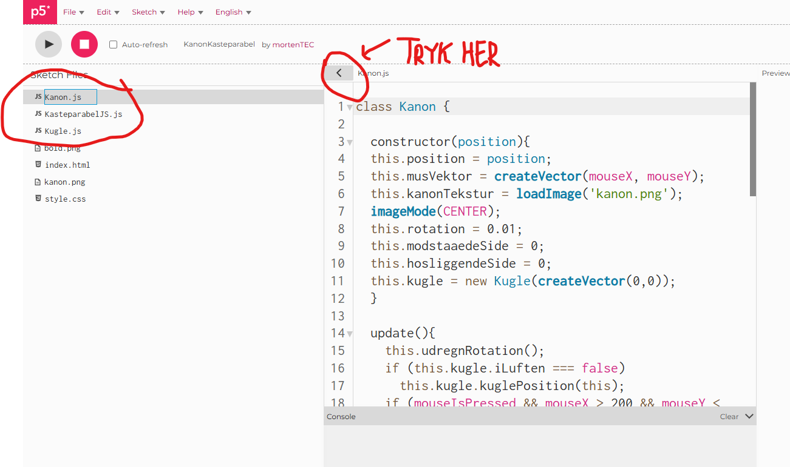

# del 13 : Programmeringsopgave, kanon-kasteparabel
Bemærk: Dette er en lidt svær opgave, som kræver, at I bruger god tid på at sætte jer grundigt ind i koden først.

Åbn koden her: [KanonKasteparabel](https://editor.p5js.org/mortenTEC/sketches/t4jsUIVxb)

Sæt dig ind i, hvordan programmet er delt op i en hovedfil og to klasse-filer.
Se på billedet nedenfor hvordan du ser alle filerne i editoren. 
Opgaverne står under billedet.

## ⚠️ Regler for koden
Ingen nye klasser.

Eksisterende funktioners input/output (signaturer) må ikke ændres.

## Opgaver
- Følg musen: Sørg for, at kanonen drejer og peger mod musen konstant.

- Brugerstyret tyngdekraft: Gør det muligt for brugeren at ændre tyngdekraften dynamisk undervejs.

- Brugerstyret affyringskraft: Gør det muligt at styre kanonkuglens affyringskraft (hastighed).

- Lav eventuelt andre sjove ændringer :-)