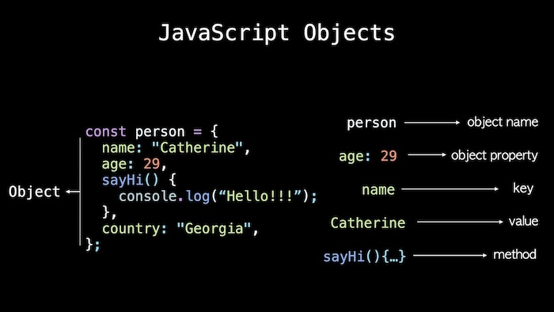

# del 10 : Objektorienteret programmering 1 - Objekter


[//]: # (-----------------------------------------------------------------------------------------------------------------------------)
[//]: # (--------------------------------------------VIGTIG VIDEN FRA SIDST-----------------------------------------------------------)
[//]: # (-----------------------------------------------------------------------------------------------------------------------------)


<details class="blue">
  <summary>fra sidst : rekursion</summary>

En rekursiv funktion er en funktion, der kalder sig selv.
Man skal altid have to ting:

1. Base case → hvornår stopper vi?
2. Recursive step → funktionen kalder sig selv med et "mindre" problem.


</details>


[//]: # (-----------------------------------------------------------------------------------------------------------------------------)
[//]: # (--------------------------------------------------NYT EMNE Objekter---------------------------------------------------------)
[//]: # (-----------------------------------------------------------------------------------------------------------------------------)

   <details class = "green">
    <summary>Nyt Emne : Objekter</summary> 

Hvad er et Objekt ? I objekt orienteret programmering arbejder ved at organiserer koden omkring objekter istedet for forskellige data og funktioner.
I modsætning af af fx en en enkelt variable så kan Objekter gemme flere forskellige typer af data.  </br>
JS indeholder bla. følgende indbyggede typer:
- **Indbyggede primitive** : string, number, boolean, bigint, undefinded, null og symbol
- **Indbyggede objekter** : Array ... og mange andre


Et objekt kan indeholde følgende:
- **oprettes** : vha. "krølle-paranteser", og indholdet adskilles af "kommaer"
- **properties** : indholder en nøgle og en værdi. Nøglen er navnet på den tilhørende værdi. Her arbejdes med en combination af key:value.
- **method** :Et objekt kan indeholde "metoder" som faktisk bare er funktioner, men nu tilhører de selve objektet

 


For at få adgang til og undersøge og manipulere indholdet i et objekt, kan man bruge følgende måder:
- **punkt-notationen**: **obj.property**. eller **obj.method(...)**
- **firkantparanteser**:, som et array: **obj["property"]**. Firkantede parenteser tillader også at tage nøglen fra en variabel, f.eks **obj[varWithKey]**
- **sletning**: Vi kan også slette en nøgle og dens værdi ved at bruge **delete obj.key**
- **in-operator** : For at teste om en nøgle findes så kan vi bruge **"in" operatoren**. 
- ***kopiere objekter** : Kan bla. gøres således **Object.create(mitObjekt)**

***This***:
Når vi anvender objekter kan man bruge keyworded "this" til at skelne mellem kode udenfor objektet og koden inden-i objektet.
This er egentlig bare det objekt "som koden er inde i" altså betyder "this.x" x variablen inde i objektet  

Eksempel på et objekt, og anvendelsen af "this":
```
let vektor = {
  x: 100,
  y: 100,
  z: 100,
  set(x,y){
    this.x = x
    this.y = y
  }
}
```

Brug af in:
```
 print( "x" in vektor ).  //udskriver true

for(k in vektor){
    print(k)      //udskriver alle keys i objektet
}
```

Brug af firkant-operatorer til properties:
```
print(vektor["x"]);  //udskriver 100
 
let pnavn = "x"
print(vektor[pnavn]) //udskriver 100
```

Sletning af properties:
```
delete vektor.x;
print(vektor["x"]);  //udskriver undefined
```

Kopier et objekt:
```
let vektor2 = Object.create(vektor);
```

</details>

<details class = "green">
    <summary>Dagens opgaver</summary> 

Du kan evt. tage udgangspunkt i denne kode, til dagens opgaver
```
        let Cirkledata = {
             x: 200,
            y: 200,
            d: 200,
            c:null, 
            navn: "cirkle"
        }

        function setup() {
            createCanvas(400, 400);
             Cirkledata.c = random(255);
            Cirkledata.isVisible = true;
            Cirkledata.navn = "yahoo"
            console.log(Cirkledata);
  
        }

        function draw() {
             background(220);
             fill(0)
            text(Cirkledata.navn, 50,50, 50);
             textSize(32);
  
             if (Cirkledata.isVisible) {
            fill(Cirkledata.c, 255, 50, 255)
         }
  
            circle(Cirkledata.x, Cirkledata.y, Cirkledata.d)
        }
```


**opgave 1.** 

- opret et tomt objekt kaldes Cirkledata. 

- tilføj  en key X som har en værdi af 200. 

- tilføj  en key med en string værdi. 

- Slet X ved at skrive kode i din function setup.

console.log efter hvert trin for at se resultatet.


**opgave 2.**


**2.1** 

Lav det så cirklen skifter til en tilfældig farve, når du klikker på canvas.

Tip: Brug mousePressed() og random(255) til at ændre Cirkledata.c.


**2.2**  	

Tilføj en funktion så når du trykker en tast (f.eks. 'h'), skifter Cirkledata.isVisible mellem true og false.


**2.3**

Lav et array circles, hvor du kan have flere cirkler. Hver cirkel skal have samme egenskaber som Cirkledata.

Brug funktionen setup() til at oprette mindst 3 cirkler med forskellige farver, positioner og størrelser.

Brug en for-loop i draw() til at tegne alle cirklerne.


**2.4** 

Brug nedarvning fra en et objekt til at oprette flere cirkler.

evt. ændre værdierne på nøglerne til det nye objekt.
</details>


<details class = "green">
    <summary>Bonus opgave</summary> 

Byg dit eget Vektor objekt som du kan anvende i koden fra sidst:  "for det rekursive træ"

Det er nu også nødvendigt at objekterne anvender indeholder funktioner,- brug gerne nedenstående kode:

```
let vektor = {
  x : 10,
  y :10,
  setVektor(x,y){
    this.x =x;
    this.y= y;
  }
}

function setup() {
  createCanvas(400, 400);
  let vektor2 = Object.create(vektor);
  vektor2.setVektor(10,20);
  print(vektor2.x + " "+vektor2.y)
  print(vektor.x + " "+vektor.y)  
}
```


</details>